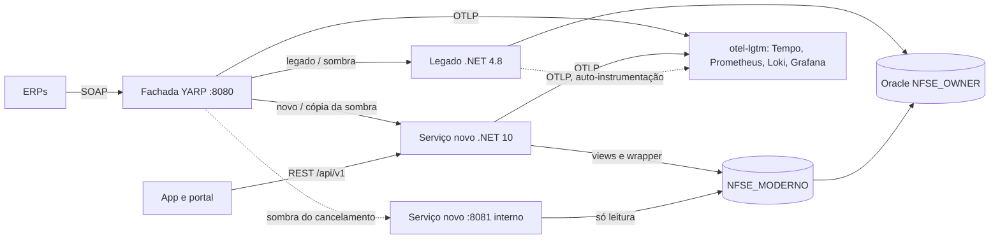

# Nota Carioca — extração da consulta e do cancelamento de NFS-e

Resposta ao [desafio de modernização](docs/desafio.md): tirar `ConsultarNfse`, `ConsultarNfseServicoTomado` e `CancelarNfse` de dentro do monolito .NET Framework + Oracle **sem que nenhum ERP perceba**, com caminho de volta a qualquer momento.

## Em resumo

- **As três operações estão extraídas** para um serviço novo em .NET 10, atrás de uma fachada que decide, por operação, entre `legado`, `sombra` e `novo`, com canário por prestador e percentual e kill switch em segundos.
- **O contrato SOAP do serviço novo é idêntico ao do legado byte a byte** em 45 dos 47 casos do golden master capturado do legado, contra Oracle real. As 2 diferenças são decisões conscientes do catálogo (DTD recusada e `soap:Fault` sem a mensagem interna do Oracle).
- **O cancelamento continua decidido pelo PL/SQL do legado**, chamado por um wrapper em schema próprio que acrescenta lock e devolve o snapshot. A regra também existe no domínio como função pura e roda em paralelo (dual-run) para medir divergências. Nenhuma tabela do legado foi alterada.
- **A sombra funciona para leitura e para escrita.** No cancelamento, o novo avalia a decisão **sem escrever**, com um usuário Oracle só de leitura, sobre o estado anterior reconstruído.
- **Comportamentos não documentados encontrados e testados**, entre eles dois bugs do legado confirmados em execução: a guia que não desconta a nota cancelada (K07) e a escrita dupla em cancelamentos concorrentes (K08). Catálogo completo em [ADR-0004](docs/adr/0004-comportamentos-legados-nao-documentados.md).
- Cerca de 400 testes: unitários, arquitetura, integração com Oracle real, contrato REST e paridade.



## Como rodar

Pré-requisitos: Docker com pelo menos 8 GB para a VM (o Oracle usa 2 a 3 GB) e, para os testes, o SDK do .NET 10.

```bash
cp .env.example .env                 # senhas e token admin de desenvolvimento
docker compose up -d --build --wait  # Oracle (com carga e NFSE_MODERNO), legado, fachada, serviço novo e otel-lgtm
tools/smoke-compose.sh               # health e ConsultarNfse igual pela fachada e direto no legado
```

A primeira subida carrega cerca de 2 milhões de notas, o que leva perto de 1 minuto num Mac M-series. `docker compose down -v` derruba tudo e apaga o banco.

| Serviço | Endereço | Observação |
| --- | --- | --- |
| Fachada (SOAP) | `http://127.0.0.1:8080/NfseWS.asmx` | todo o SOAP entra por aqui |
| Fachada (admin) | `http://127.0.0.1:8081/admin/kill-switch` | header `X-Admin-Token` (`FACHADA_ADMIN_TOKEN` do `.env`) |
| Serviço novo | `http://127.0.0.1:8090` | SOAP `/NfseWS.asmx`, REST `/api/v1`, OpenAPI `/openapi/v1.json`; a porta interna 8081 não é publicada |
| Grafana | `http://127.0.0.1:3000` | dashboard **NFS-e › Migração por operação**, traces no Tempo, logs no Loki |
| Oracle | `127.0.0.1:1521/FREEPDB1` | `NFSE_OWNER` (legado), `NFSE_MODERNO_APP` e `NFSE_MODERNO_RO` (serviço novo) |

O legado não publica porta: só é alcançável pela fachada.

### Testes

```bash
dotnet test Nfse.Moderno.slnx                     # unitários, arquitetura, fachada, host, contrato REST e SOAP
dotnet test Nfse.Moderno.slnx --filter Categoria=Contrato   # só os testes de contrato
dotnet test legado/tests/NotaCarioca.Testes -f net8.0

# paridade com o golden master, com o compose de pé
export NFSE_PARIDADE_ORACLE="User Id=NFSE_MODERNO_APP;Password=moderno_app_dev_123;Data Source=127.0.0.1:1521/FREEPDB1"
export NFSE_PARIDADE_ORACLE_RO="User Id=NFSE_MODERNO_RO;Password=moderno_ro_dev_123;Data Source=127.0.0.1:1521/FREEPDB1"
dotnet test tests/Nfse.Paridade.Testes
```

Os testes de contrato (`Categoria=Contrato`, step próprio no CI) comparam o `/openapi/v1.json` do Host com o snapshot versionado em [tests/Nfse.Host.Testes/Contrato/openapi-v1.json](tests/Nfse.Host.Testes/Contrato/openapi-v1.json) e a forma das respostas SOAP (elementos, namespaces, ordem e códigos de erro) com as respostas reais do legado em [tools/exemplos](tools/exemplos). Mudança intencional na REST: `NFSE_ATUALIZAR_CONTRATO=1 dotnet test tests/Nfse.Host.Testes --filter Categoria=Contrato` regenera o snapshot, e o diff entra no PR.

A paridade do cancelamento muda o banco, então exige a linha de base restaurada e o relógio congelado. O procedimento está em [tests/paridade/README.md](tests/paridade/README.md).

## Como alternar os modos e ver o resultado

Os modos ficam em [`deploy/flags/flags.json`](deploy/flags/flags.json). A fachada recarrega o arquivo em segundos, sem restart. Tudo começa em `legado`. As mesmas flags também podem vir de OpenFeature + flagd (`FACHADA_FLAGS_FONTE=openfeature docker compose --profile flagd up -d`, editando [`deploy/flags/flagd.json`](deploy/flags/flagd.json)), como em produção; ver o [README da fachada](src/Nfse.Fachada/README.md#openfeature--flagd).

```json
"ConsultarNfse": { "Modo": "legado", "Percentual": 0, "KillSwitch": false, "Inclusao": [], "Exclusao": [], "Sombra": { "Amostragem": 0 } }
```

| Para | Altere | Efeito |
| --- | --- | --- |
| **Sombra** | `"Modo": "sombra"`, `"Sombra": { "Amostragem": 100 }` | o ERP recebe o legado; o novo é comparado fora do caminho |
| **Canário por prestador** | `"Modo": "novo"`, `"Inclusao": ["10000001"]` | só esse prestador é atendido pelo novo |
| **Canário por percentual** | `"Modo": "novo"`, `"Percentual": 10` | 10% das chaves (hash estável por prestador) vão ao novo |
| **Novo 100%** | `"Modo": "novo"`, `"Percentual": 100` | a operação inteira é atendida pelo novo |
| **Kill switch** | `"KillSwitch": true` na operação ou em `Migracao` | tudo volta ao legado |

Kill switch de emergência sem mexer no arquivo, válido na réplica:

```bash
curl -X POST -H "X-Admin-Token: desenvolvimento-local" http://127.0.0.1:8081/admin/kill-switch                        # global
curl -X POST -H "X-Admin-Token: desenvolvimento-local" "http://127.0.0.1:8081/admin/kill-switch?operacao=CancelarNfse"
curl -X DELETE -H "X-Admin-Token: desenvolvimento-local" http://127.0.0.1:8081/admin/kill-switch
```

### Roteiro de demonstração

Envie um exemplo e mude o modo entre um envio e outro:

```bash
tools/exemplos/executar.sh http://127.0.0.1:8080/NfseWS.asmx 04-consultar-nfse.xml
docker compose logs --since 30s fachada | grep -o '"Message":"SOAP[^"]*"'
```

Foi o que este roteiro mostrou no compose:

| Modo | Log da fachada | Resultado |
| --- | --- | --- |
| `legado` | `SOAP ConsultarNfse -> Legado (ModoLegado) status 200` | resposta do legado |
| `sombra` | `SOAP ConsultarNfse -> Legado (Sombra) status 200` | `sombra_comparacoes_total{resultado="igual"}` |
| `novo` 100% | `SOAP ConsultarNfse -> Novo (Percentual) status 200` | resposta **idêntica** à do legado (`cmp`) |
| kill switch | `SOAP ConsultarNfse -> Legado (KillSwitch) status 200` | de volta ao legado |
| `sombra` no `CancelarNfse` (06e) | `SOAP CancelarNfse -> Legado (Sombra) status 200` | avaliação sem escrita no novo: `igual` |

No Grafana, o dashboard **Migração por operação** mostra as requisições por destino e resultado, o p99 de cada lado, os fallbacks e a linha **Sombra** (comparações, divergências por classe, descartes e atraso). Cada requisição tem trace no Tempo, com o span da fachada e o span filho do destino; os logs carregam `TraceId`.

O legado também aparece no trace, sem nenhuma linha de código alterada: o container dele leva a auto-instrumentação OpenTelemetry .NET (v1.17.0, fixada no [Dockerfile](Dockerfile)), que o compose liga por variável de ambiente ([ADR-0012](docs/adr/0012-observabilidade-seguranca-e-lgpd.md#legado-instrumentado-por-fora-opcional)). Um `ConsultarNfse` pela fachada fica assim no Tempo (busque `{resource.service.name="nfse-legado"}` ou abra um trace da fachada):

```text
[nfse-fachada] POST /NfseWS.asmx                 server  soap.operacao, migracao.*
  [nfse-fachada] POST                            client  webservices:8080
    [nfse-legado] POST /NfseWS.asmx              server  traceparent recebido da fachada
      [nfse-legado] Fill(DataTable)              client  db.system=oracle, sem SQL
        [nfse-legado] SendExecuteRequest         client  ida e volta ao Oracle
```

Os logs do ASP.NET Core do legado chegam ao Loki com o mesmo `trace_id`. Nenhum span ou log leva SQL, corpo SOAP, cabeçalho ou documento (conferido com os CPFs/CNPJs/IMs dos exemplos). O painel **Legado: p99 visto pela fachada × medido dentro do legado** compara a chamada vista de fora com o tempo medido dentro do processo. Numa amostra local de 42 consultas **[M]**, o legado gastou 85% do tempo no Oracle (mediana), e rede mais fila entre a chamada da fachada e o servidor do legado ficaram em 7 ms (mediana). Com o agente desligado (sem as variáveis `CORECLR_*`/`DOTNET_STARTUP_HOOKS`), o legado roda como em produção.

> `tools/exemplos/executar.sh` sem argumentos também envia o lote (`01`) e o cancelamento (`06`), que mudam o banco.

### API REST

A API exige JWT. A claim `inscricoes` autoriza por prestador, e a claim `documento` identifica o tomador. Em desenvolvimento, rode o serviço novo localmente e gere um token com o `dotnet user-jwts`:

```bash
TOKEN=$(dotnet user-jwts create --project src/Nfse.Host --audience nfse-api \
  --claim inscricoes=10000001 --claim documento=01234567000195 --output token)
ConnectionStrings__Oracle="User Id=NFSE_MODERNO_APP;Password=moderno_app_dev_123;Data Source=127.0.0.1:1521/FREEPDB1" \
  Porta=8095 Interno__Porta=8096 ASPNETCORE_ENVIRONMENT=Development dotnet run --project src/Nfse.Host --no-launch-profile &
curl -H "Authorization: Bearer $TOKEN" "http://127.0.0.1:8095/api/v1/prestadores/10000001/nfse?dataInicial=2026-10-01&dataFinal=2026-10-31"
curl -H "Authorization: Bearer $TOKEN" "http://127.0.0.1:8095/api/v1/tomador/nfse?dataInicial=2026-10-01&dataFinal=2026-10-31"
```

No compose, o serviço novo não tem emissor de tokens configurado, então a REST responde 401. Em produção, o emissor é o IdP da Prefeitura ([ADR-0010](docs/adr/0010-contrato-da-api-rest-v1.md)).

## Decisões

O índice completo, com o status e o mapa entre as decisões, está em [docs/adr/](docs/adr/README.md). O [plano de migração](docs/plano-de-migracao.md) traz os critérios de avanço e retorno de cada fase.

| ADR | Decisão |
| --- | --- |
| [0001](docs/adr/0001-estrategia-strangler-fig-e-ordem-de-extracao.md) | Strangler fig por operação; ordem `ConsultarNfse` → `ServicoTomado` → `CancelarNfse` |
| [0002](docs/adr/0002-propriedade-dos-dados-na-transicao.md) | O legado continua dono dos dados; o novo lê o mesmo Oracle por views e usa três usuários com menor privilégio |
| [0003](docs/adr/0003-regras-de-cancelamento-em-plsql.md) | PL/SQL encapsulado como autoridade (wrapper com lock e snapshot); regra espelhada no domínio para dual-run |
| [0004](docs/adr/0004-comportamentos-legados-nao-documentados.md) | Catálogo de comportamentos legados: preservar no SOAP, corrigir na REST, decisões de segurança |
| [0005](docs/adr/0005-correcao-do-trigger-de-recalculo-da-guia.md) | Correção do trigger da guia (**proposta**, depende de aprovação de negócio) |
| [0006](docs/adr/0006-camada-anticorrupcao.md) | Camada anticorrupção: o domínio não conhece XML, SOAP nem os códigos do legado |
| [0007](docs/adr/0007-arquitetura-do-servico-novo.md) | .NET 10, clean architecture, CQRS pragmático, Dapper; sem MediatR nem EF |
| [0008](docs/adr/0008-fachada-yarp-roteamento-e-flags.md) | Fachada YARP north-south, flags e kill switch, sem service mesh |
| [0009](docs/adr/0009-sombra-escrita-unica-e-idempotencia.md) | Sombra por operação; cancelamento avaliado sem escrita; escrita única; idempotência natural |
| [0010](docs/adr/0010-contrato-da-api-rest-v1.md) | REST `/api/v1`, cursor keyset, ProblemDetails, JWT, nenhum documento em URL |
| [0011](docs/adr/0011-paridade-golden-master.md) | Golden master com relógio congelado e banco restaurável |
| [0012](docs/adr/0012-observabilidade-seguranca-e-lgpd.md) | OpenTelemetry, métricas que decidem fase, dados pessoais fora da telemetria |

Pontos que valem a conversa:

- **Por que o PL/SQL continua mandando no cancelamento.** Assim há um só caminho de escrita, o rollback é trocar uma flag sem reconciliar dados, e o trigger da guia continua valendo. O wrapper corrige no caminho novo dois defeitos do legado que o [spike](docs/spikes/2026-10-19-premissas-oracle.md) confirmou: a escrita dupla em cancelamentos concorrentes (K08) e o Fault depois do commit (K09).
- **O bug da guia (K07) não foi corrigido dentro da migração.** Corrigir no meio tornaria cada divergência ambígua (bug da migração ou efeito da correção?). A correção está pronta e é reversível, mas fica separada, como proposta ([ADR-0005](docs/adr/0005-correcao-do-trigger-de-recalculo-da-guia.md)).
- **A sombra do cancelamento não escreve.** Ela usa o usuário `NFSE_MODERNO_RO`, que não tem `EXECUTE` no wrapper. A garantia vem do banco, não do código.
- **Números com origem.** Cada limite e meta nas ADRs diz se veio do enunciado, do código do legado ou se é hipótese a calibrar no M0.

## Estrutura

```
src/Nfse.Fachada            proxy YARP: roteamento, flags, kill switch, sombra
src/Nfse.Dominio            documento, período, competência, política de cancelamento
src/Nfse.Aplicacao          casos de uso de leitura e de cancelamento, portas
src/Nfse.Infra.Oracle       views, wrapper e usuário só leitura (Dapper + ODP.NET)
src/Nfse.Adaptadores.Soap   camada anticorrupção (contrato do legado)
src/Nfse.Adaptadores.Rest   API /api/v1
src/Nfse.Host               composição do serviço novo
db/moderno                  schema NFSE_MODERNO: usuários, views e wrapper
tests/paridade              golden master: 47 casos capturados do legado
tests/carga                 teste de carga k6, legado × novo pela fachada
deploy/                     flags, dashboards do Grafana e manifests Kubernetes (Kustomize)
docs/                       ADRs, plano de migração, spike de premissas, enunciado
legado/, db/0*, tools/      monolito original (inalterado)
```

## O que eu faria com mais tempo

- **Medir antes de afirmar.** Rodar o M0 do plano (fachada em pass-through em produção) para trocar as hipóteses **[H]** das ADRs por números de produção: orçamento da fachada, timeouts, amostragem e limites de rollback. O teste k6 local ([tests/carga](tests/carga/README.md)) só mostra que o novo não piora a cauda e aguenta mais carga que o legado no mesmo hardware.
- **Rodar os testes contra Oracle 19c.** O ambiente local é 23ai, e os códigos de erro já se mostraram diferentes (`ORA-41900` × `ORA-01031`, `ORA-00054` × `ORA-30006`).
- **Completar o CI.** Feito: o CI roda build, testes (com os de contrato num step próprio), a validação dos manifests com `kubeconform` (job `manifests`), o compose e a paridade completa: leituras, sombra do cancelamento e, num step próprio depois delas, o cancelamento com `FIXED_DATE` ([tests/paridade](tests/paridade/README.md#no-ci)). Os dois overlays já foram aplicados e testados em k3d ([deploy/k8s](deploy/k8s/README.md#validação)). O de produção subiu com Argo Rollouts, flagd, External Secrets (cofre fake) e ingress-nginx. Canários da fachada e do serviço novo passaram pela análise contra o Prometheus. O rollback, automático e manual, tirou o canário em ~6 s, com 0 falhas em 8.762 requisições. Falta aplicar os manifests num cluster com o CNI de produção.
- **Tirar o ConfigMap de flags do overlay de produção.** O kill switch pelo flagd já foi medido no compose (0,4 s até 100% no legado) e no cluster, pelo CR `FeatureFlag` (0,12–0,24 s nas 3 réplicas) **[M]**; o arquivo de flags ainda está montado e pode sair do overlay.
- **Aplicar a correção do trigger da guia**, depois da aprovação da Fazenda, com o relatório de reconciliação das guias em aberto ([ADR-0005](docs/adr/0005-correcao-do-trigger-de-recalculo-da-guia.md)).
- **Cobrir o que o seed não exercita:** C13 (competência posterior à emissão) e C15 (colisão CPF × CNPJ) precisam de massa própria.
- **Testes de resiliência automatizados** com Oracle lento ou fora do ar. Hoje os casos de novo lento e fora do ar são cobertos só nos testes da fachada.
- **Fase 2 da sombra:** payload cifrado para reprodução exata das divergências e sombra invertida (o novo atende, o legado é comparado).
- **Acompanhar o PR-212** depois da revisão ([revisao/REVIEW-PR-212.md](revisao/REVIEW-PR-212.md)): parear com o autor sobre DI, async e HttpClientFactory.
