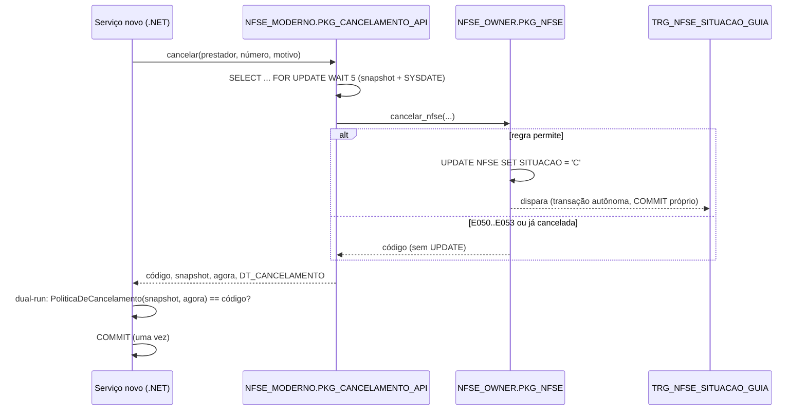

# ADR-0003 — Regras de cancelamento em PL/SQL: encapsular, espelhar no domínio

- **Status:** Aceito
- **Data:** 2026-10-16
- **Relacionados:** [0002](0002-propriedade-dos-dados-na-transicao.md), [0004](0004-comportamentos-legados-nao-documentados.md), [0005](0005-correcao-do-trigger-de-recalculo-da-guia.md), [0009](0009-sombra-escrita-unica-e-idempotencia.md)

## Contexto

O cancelamento hoje é:

```
CancelamentoNfseServico (C#) ──► PKG_NFSE.cancelar_nfse ──UPDATE NFSE.SITUACAO──► TRG_NFSE_SITUACAO_GUIA
                                 E050 → 'C' ok → E051 →                           (FOR EACH ROW, AUTONOMOUS_TRANSACTION)
                                 E052 → E053 → UPDATE                               └► PKG_GUIA.recalcular_guia + COMMIT
```

Fatos (leitura de `db/03_pkg_nfse.sql:67-120`, `db/04_triggers.sql`, `db/02_pkg_guia.sql`, `legado/src/NotaCarioca.Dados/NfseRepositorio.cs:59-82`):

1. **Ordem das regras:** nota inexistente → `E050`; já cancelada → **sucesso sem UPDATE** (idempotente, antes do prazo); substituída → `E051`; `NOT (SYSDATE < ADD_MONTHS(COMPETENCIA,1)+10)` → `E052`; guia da competência `'P'` → `E053`; senão `UPDATE` de `SITUACAO`, `DT_CANCELAMENTO=SYSDATE`, `MOTIVO=SUBSTR(p_motivo,1,255)`.
2. **O prazo usa o relógio do banco** (`SYSDATE`). Com competência sempre no dia 1, vale até o dia 10 às 23:59:59 do mês seguinte, no fuso do servidor de banco.
3. **Sem lock entre checagem e escrita.** Dois cancelamentos simultâneos da mesma nota passam pela checagem; o segundo espera o lock de linha e faz um segundo `UPDATE` (o trigger dispara duas vezes e `DT_CANCELAMENTO` é sobrescrito). É uma escrita executada duas vezes.
4. **Trigger com transação autônoma.** O recálculo da guia lê o estado já commitado, no qual a nota ainda é `'N'`. A guia **não desconta** a nota recém-cancelada (fica um cancelamento atrasada; em cancelamento em massa, nenhuma nota do comando é descontada). A origem provável é contornar o erro de tabela mutante (`ORA-04091`) de um trigger por linha que consulta a própria tabela. Tratado em [ADR-0005](0005-correcao-do-trigger-de-recalculo-da-guia.md).
5. **Efeitos que escapam de rollback.** O `COMMIT` autônomo persiste o recálculo mesmo se a transação do chamador for desfeita. Como o recálculo usa o estado anterior, o valor de uma guia existente não muda, mas `DT_ATUALIZACAO` muda e, se a guia da competência ainda não existir, o `MERGE` a **cria** (`db/02_pkg_guia.sql:29-31`) e ela fica commitada. Isso torna inviável qualquer "dry-run com rollback".
6. **`recalcular_guia` é idempotente** (MERGE com valor função do estado commitado).
7. No C#, o `Commit` é incondicional e a releitura de `DT_CANCELAMENTO` acontece **depois** do commit, fora da transação (`CancelamentoNfseServico.cs:49-50`): uma falha nesse ponto devolve Fault 500 ao ERP com o cancelamento já efetivado.

### Premissas e nível de verificação

| # | Premissa | Fonte | Nível | Como confirmar | Se for falsa |
| --- | --- | --- | --- | --- | --- |
| P1 | Ordem das regras `E050` → já cancelada → `E051` → `E052` → `E053` | `db/03_pkg_nfse.sql:77-112` | **confirmada** pelo golden master (casos 201–212) | golden master K02 | — |
| P2 | O trigger autônomo não desconta a nota que está sendo cancelada (K07) | `db/04_triggers.sql:9-12` + semântica de transação autônoma | **confirmada em execução**: guia 1557,01 × correta 1267,86 ([spike](../spikes/2026-10-19-premissas-oracle.md)) | teste de integração K07: cancelar e ler a guia | a ADR-0005 perde o objeto; K07 sai do catálogo |
| P3 | O `PRAGMA` existe para contornar `ORA-04091` | comentário de 2019 no trigger | hipótese | não precisa: não muda a decisão | — |
| P4 | Dois cancelamentos simultâneos produzem dois `UPDATE` (K08) | `db/03_pkg_nfse.sql:78-119`, sem lock | **confirmada em execução**: motivo sobrescrito pela 2ª sessão ([spike](../spikes/2026-10-19-premissas-oracle.md)) | teste de concorrência contra a procedure direta; a correção pelo wrapper tem teste automático (`GarantiaK08Tests`, job `compose`) | o lock do wrapper continua inofensivo |
| P5 | O `COMMIT` autônomo persiste mesmo com rollback do chamador, inclusive criando guia | `db/02_pkg_guia.sql:29-31`, `db/04_triggers.sql:12` | lida (inferência) | teste: cancelar, `ROLLBACK`, contar guias | — |
| P6 | `recalcular_guia` é idempotente | `db/02_pkg_guia.sql:16-31` | lida | chamar duas vezes e comparar `VALOR_ISS` | — |
| P7 | A competência é sempre o dia 1 do mês | `ProcessadorLoteRps.cs:146`; seeds com `TRUNC(...,'MM')` | **confirmada no seed**; produção a confirmar | `SELECT COUNT(*) FROM NFSE WHERE COMPETENCIA <> TRUNC(COMPETENCIA,'MM')` = 0 | a regra de prazo do domínio precisa replicar `ADD_MONTHS` sobre a data exata |
| P8 | O `SYSDATE` de produção está em horário de São Paulo | `docker-compose.yml:5` (só o ambiente local) | local: segue o fuso do SO do container; **produção desconhecida** | perguntar ao DBA do 19c (`SELECT DBTIMEZONE, SESSIONTIMEZONE`, fuso do SO) | o prazo do dia 10 já vira em outro horário hoje; preservar, documentar como K03 |
| P9 | `SELECT ... FOR UPDATE` sobre tabela de outro schema funciona com `SELECT` direto ao dono do wrapper | documentação Oracle | **confirmada** ([spike](../spikes/2026-10-19-premissas-oracle.md)) | teste de integração do wrapper | grant de `LOCK` específico ou mover o lock para dentro de uma view com `SELECT` |

## Decisão

### 1. O PL/SQL continua sendo a única autoridade de escrita

O serviço novo cancela chamando `NFSE_OWNER.PKG_NFSE.cancelar_nfse` através de um pacote wrapper no schema próprio:

```sql
-- NFSE_MODERNO.PKG_CANCELAMENTO_API (definer rights, dono NFSE_MODERNO, grants diretos — ADR-0002)
PROCEDURE cancelar(p_prestador_id     IN  NUMBER,
                   p_numero           IN  NUMBER,
                   p_motivo           IN  VARCHAR2,
                   o_codigo_erro      OUT VARCHAR2,   -- NULL = sucesso (cancelou agora ou já estava cancelada)
                   o_situacao_antes   OUT VARCHAR2,   -- snapshot lido DENTRO do lock
                   o_competencia      OUT DATE,
                   o_guia_paga_antes  OUT NUMBER,     -- 0/1
                   o_agora_banco      OUT DATE,       -- SYSDATE lido dentro do lock, antes da regra
                   o_dt_cancelamento  OUT DATE) IS
BEGIN
    BEGIN
        SELECT SITUACAO, COMPETENCIA INTO o_situacao_antes, o_competencia
          FROM NFSE_OWNER.NFSE
         WHERE PRESTADOR_ID = p_prestador_id AND NUMERO = p_numero
           FOR UPDATE WAIT 5;                          -- serializa cancelamentos da mesma nota
    EXCEPTION
        WHEN NO_DATA_FOUND THEN o_codigo_erro := 'E050'; RETURN;   -- mesmo resultado que cancelar_nfse daria
    END;                                               -- lock não obtido em 5 s: ORA-30006 (19c) ou ORA-00054 (23ai), erro técnico
    SELECT SYSDATE INTO o_agora_banco FROM DUAL;
    SELECT COUNT(*) INTO o_guia_paga_antes FROM NFSE_OWNER.GUIAS
     WHERE PRESTADOR_ID = p_prestador_id AND COMPETENCIA = o_competencia AND SITUACAO = 'P';
    NFSE_OWNER.PKG_NFSE.cancelar_nfse(p_prestador_id, p_numero, p_motivo, o_codigo_erro);   -- regra intocada
    SELECT DT_CANCELAMENTO INTO o_dt_cancelamento FROM NFSE_OWNER.NFSE
     WHERE PRESTADOR_ID = p_prestador_id AND NUMERO = p_numero;
END;                                                   -- COMMIT é do chamador (.NET), uma única vez
```



(O `SELECT` em `GUIAS` usa o privilégio `READ` do dono; só `NFSE` precisa de `SELECT` para o `FOR UPDATE`.)

- O wrapper **não reimplementa nenhuma regra**. Ele só acrescenta, no caminho novo:
  - **lock de linha (`FOR UPDATE WAIT 5`)**: o segundo cancelamento simultâneo espera, encontra `'C'` e sai pelo caminho idempotente, sem segundo `UPDATE` (fato 3). Estouro da espera vira erro técnico (`soap:Fault` / `500`), nunca um código de negócio;
  - **snapshot e `SYSDATE` lidos dentro do lock**, antes da regra: é sobre eles que o domínio roda o dual-run, sem corrida;
  - **`DT_CANCELAMENTO` devolvido na mesma transação**, eliminando a releitura pós-commit (fato 7).
- O `SYSDATE` usado na linha 98 de `cancelar_nfse` pode cair no segundo seguinte ao `o_agora_banco`. Divergências do dual-run a menos de 2 s da fronteira do prazo são classificadas como `fronteira_relogio`, não como erro de regra.
- Trocar `legado` ↔ `novo` não muda o estado do banco: a mesma procedure decide nos dois caminhos.

### 2. A regra é espelhada no domínio como função pura

`PoliticaDeCancelamento.Avaliar(SituacaoAtual, Competencia, GuiaPaga, Agora) → Permitido | Negado(Motivo)` no domínio do serviço novo:

- sem SOAP, sem códigos `E05x`, sem `SYSDATE`: o instante "agora" é **parâmetro**;
- mesma ordem de avaliação do PL/SQL (inclusive "já cancelada = permitido/idempotente" antes do prazo);
- usos:
  - avaliar a **sombra** do cancelamento sem escrever ([ADR-0009](0009-sombra-escrita-unica-e-idempotencia.md));
  - em modo `novo`, avaliar o snapshot devolvido pelo wrapper (lido sob lock) e comparar com o código que o PL/SQL devolveu (**dual-run**). Se divergirem, vale o PL/SQL e a divergência vira métrica `cancelamento_regra_divergente_total`.
- é a ponte mensurável para um dia aposentar o PL/SQL: com o dual-run zerado por tempo suficiente e a guia também extraída, a autoridade pode mudar de lado.

### 3. Fonte única de tempo

O "agora" usado pelo domínio é o `SYSDATE` lido do Oracle junto com o snapshot da nota (na sombra) ou devolvido pelo wrapper (em modo novo). O serviço novo **nunca** decide prazo com o relógio do pod. Isso elimina a diferença de fuso e de relógio entre pod e banco; resta apenas a janela de 1 s entre duas leituras de `SYSDATE`, tratada como `fronteira_relogio`.

### 4. O bug do trigger é preservado durante a migração

A migração não muda resultado de negócio. A correção é uma mudança separada, com rollback próprio, em [ADR-0005](0005-correcao-do-trigger-de-recalculo-da-guia.md).

### 5. Fora de escopo

`gerar_nfse`, `PKG_GUIA` e o cálculo de ISS continuam exclusivos do legado. O serviço novo não recalcula ISS: exibe `VALOR_ISS` gravado.

### Números desta ADR

| Valor | Origem | Onde calibrar |
| --- | --- | --- |
| `FOR UPDATE WAIT 5` (5 s de espera pelo lock) | [H] | menor que o orçamento do cancelamento ([ADR-0007](0007-arquitetura-do-servico-novo.md)); medir espera real no teste de concorrência |
| Janela de 2 s para `fronteira_relogio` no dual-run | [H] | precisão de `DATE` é 1 s; 2 s cobre duas leituras de `SYSDATE`; rever com as divergências reais |
| Motivo truncado em 255 | [L] | `db/03_pkg_nfse.sql:117` |
| Prazo até o dia 10 do mês seguinte | [E] + [L] | manual e `db/03_pkg_nfse.sql:98` |

## Fora deste ADR

| Pendência | Dono | Trava |
| --- | --- | --- |
| Fuso e relógio do `SYSDATE` em produção (premissa P8) | DBA | a sombra de `CancelarNfse` |
| Aposentadoria do PL/SQL como autoridade | time de modernização + Fazenda | nada nesta migração; exige guia extraída e dual-run zerado |

## Alternativas consideradas

- **Reimplementar a regra no serviço novo e fazer `UPDATE` direto em `NFSE`.** Rejeitada: exige `UPDATE` em tabela do legado, cria duas fontes de verdade da regra fiscal durante a transição e o trigger dispara do mesmo jeito.
- **Mover a regra para um PL/SQL novo no schema próprio.** Rejeitada: perpetua regra no banco sem ganho e cria uma terceira cópia.
- **Dry-run chamando a procedure e fazendo rollback.** Rejeitada: o `COMMIT` autônomo do trigger escapa do rollback e o `UPDATE` trava a linha que o cliente real pode estar cancelando.
- **Wrapper sem `FOR UPDATE`.** Rejeitada: mantém a escrita duplicada em cancelamentos concorrentes.
- **Recalcular a guia no serviço novo após o cancelamento** (mitigar o bug do trigger só no caminho novo). Rejeitada nesta fase: a guia passaria a ter valor diferente conforme quem atendeu, o que torna as divergências ambíguas (bug de migração ou efeito da correção?).

## Consequências

- **Positivas:** uma única regra fiscal em produção; rollback por flag sem reconciliação; elimina duas falhas do caminho legado (escrita duplicada concorrente e Fault após commit) sem tocar no legado.
- **Negativas:** a regra existe em duas formas (PL/SQL autoritativo e função de domínio espelhada) até a aposentadoria; o serviço novo fica acoplado à assinatura de `cancelar_nfse`.
- **Riscos:**
  - o `FOR UPDATE` aumenta a espera em cancelamentos concorrentes da mesma nota (raros); usar `WAIT 5` e devolver erro interno se estourar;
  - o privilégio de `SELECT ... FOR UPDATE` sobre tabela de outro schema exige `SELECT` (não `READ`) — validar em teste;
  - divergência entre domínio e PL/SQL em casos não cobertos — mitigada pelo dual-run e pela métrica.

## Reversão

- Operação volta a `legado` por flag; o wrapper fica sem uso.
- Remover o wrapper: `DROP PACKAGE NFSE_MODERNO.PKG_CANCELAMENTO_API`. Nenhum objeto do legado é alterado por este ADR.

## Como verificar

Testes de integração em Oracle real ([ADR-0011](0011-paridade-golden-master.md)):

- para cada código (`E050`, `E051`, `E052`, `E053`, idempotente, sucesso), o resultado do wrapper é igual ao da chamada direta a `cancelar_nfse`;
- lock ocupado por outra sessão por mais de 5 s → erro técnico, nota inalterada;
- dois cancelamentos paralelos da mesma nota pelo wrapper produzem **um** `UPDATE` (`DT_CANCELAMENTO` não muda no segundo);
- tabela de casos da `PoliticaDeCancelamento` igual à do PL/SQL, incluindo a fronteira `dia 10 23:59:59` / `dia 11 00:00:00` (com `FIXED_DATE` no Oracle);
- teste que **prova** o fato 4 (guia não desconta a nota cancelada), mantido verde enquanto o [ADR-0005](0005-correcao-do-trigger-de-recalculo-da-guia.md) não for aplicado.
