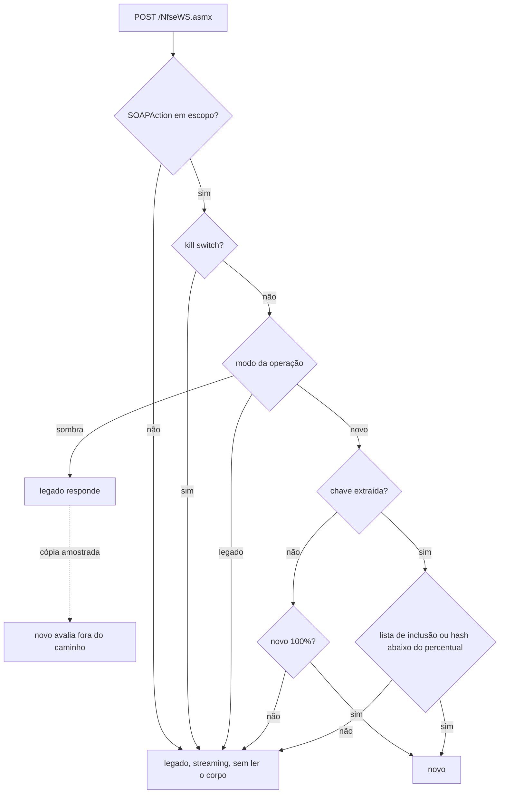

# ADR-0008 — Fachada YARP: roteamento, flags e kill switch

- **Status:** Aceito
- **Data:** 2026-10-16
- **Relacionados:** [0001](0001-estrategia-strangler-fig-e-ordem-de-extracao.md), [0006](0006-camada-anticorrupcao.md), [0009](0009-sombra-escrita-unica-e-idempotencia.md), [0012](0012-observabilidade-seguranca-e-lgpd.md)

## Contexto

Todo o tráfego de `/NfseWS.asmx` deve entrar por uma fachada que decide, **por operação**, entre `legado`, `sombra` e `novo`, com:

- controle por prestador (lista de inscrições) e por percentual;
- mudança em tempo de execução, sem deploy, e kill switch que devolve tudo ao legado em segundos;
- operações fora do escopo intactas.

Fatos:

- A operação vem do header `SOAPAction` (`Program.cs:59-60`).
- A inscrição do prestador está **dentro do `inputXML` escapado**, no corpo (`Prestador/InscricaoMunicipal` em `ConsultarNfse`; `IdentificacaoNfse/InscricaoMunicipal` em `CancelarNfse`).
- `ConsultarNfseServicoTomado` **não tem prestador**; a chave natural é o documento do consulente.
- O legado não limita o tamanho do corpo (`Program.cs:20`).

## Decisão

### Topologia (north-south / east-west)

| Tráfego | Caminho |
| --- | --- |
| ERPs → SOAP (north-south) | ingress → **fachada** → legado ou serviço novo |
| App/portal → REST (north-south) | ingress → **serviço novo** (não passa pela fachada: não há legado a estrangular) |
| Fachada → legado/novo, novo → Oracle (east-west) | HTTP/ODP.NET diretos, com propagação W3C; sem service mesh |

### Fachada

- **ASP.NET Core + YARP**, processo sem estado, ≥ 2 réplicas.
- **Operações fora do escopo:** roteadas apenas pelo header, **sem ler o corpo** (streaming), sem retry, sem transformação.
- **Operações em escopo:** o corpo é bufferizado até 1 MiB. Acima disso → legado, sem rejeitar (não introduzimos limite que o legado não tem). A chave de roteamento é extraída com parsing seguro (sem DTD, sem resolução externa):
  - `ConsultarNfse`, `CancelarNfse`: inscrição municipal;
  - `ConsultarNfseServicoTomado`: documento do consulente normalizado (só dígitos), usado apenas em memória para o hash; nunca vai para log ou métrica.
  - Falha ao extrair a chave ou corpo acima do limite → legado **enquanto a operação estiver em `sombra` ou canário**. Em `novo` 100%, **tudo** da operação vai para o novo, que reproduz as respostas do legado para esses casos (`E001`, `E010`); senão o desligamento nunca seria alcançável.

### Decisão de destino (avaliada a cada requisição)

```
kill switch (global ou da operação)?        → legado
modo == legado?                             → legado
chave na lista de exclusão?                 → legado
modo == sombra?                             → legado responde; copia para o novo se
                                              (lista de inclusão vazia ou chave nela) e amostragem sorteada
modo == novo:
    chave na lista de inclusão?             → novo
    hash(op|chave) % 100 < percentual?      → novo
    senão                                   → legado
```



- O hash é **determinístico entre processos e réplicas**: `xxHash64(operação + "|" + chave) % 100` (nunca `string.GetHashCode`, que é aleatório por processo, nem o HMAC de pseudonimização, cuja chave é rotacionada). O mesmo prestador cai sempre no mesmo lado, o que mantém a paginação coerente e respeita a escrita única ([ADR-0009](0009-sombra-escrita-unica-e-idempotencia.md)).
- **Semântica do percentual por modo:**

| Modo | `percentual` (roteamento) | `sombra.amostragem` |
| --- | --- | --- |
| `legado` | ignorado | ignorado |
| `sombra` | ignorado: o cliente sempre recebe o legado | fração das requisições (já elegíveis pelas listas) copiadas para o novo |
| `novo` | fração atendida pelo novo (canário); o restante vai ao legado | opcional: sombra invertida (novo atende, legado é comparado), só para leituras |

- **Flags com OpenFeature + provider flagd**, sincronizado por **watch** (no Kubernetes, sync do CRD `FeatureFlag` pelo flagd; no compose, arquivo observado). ConfigMap montado como volume **não** é usado: o kubelet propaga mudanças com atraso de dezenas de segundos. Toda avaliação gera métrica e atributo no span.
- **Kill switch com dois caminhos:**
  1. flag `kill-switch` no flagd (propagação em segundos);
  2. endpoint administrativo da fachada (`POST /admin/kill-switch`, autenticado, porta interna), que vale imediatamente na réplica e é aplicado em todas as réplicas pelo operador. É o caminho de emergência quando o próprio flagd está com problema.
- **Falha do provider de flags → legado** (fail-safe).

### Modo `novo` e falhas

- **Leituras:** erro de transporte, timeout ou 5xx do serviço novo → **uma** tentativa no legado (leitura é segura). Conta como `fallback` na métrica.
- **Cancelamento:** **sem fallback e sem retry** depois que a requisição foi enviada (o resultado pode ser desconhecido). Só há fallback se a conexão falhar antes do envio, e **erro numa conexão reaproveitada do pool conta como "enviado"** (não dá para saber se o corpo saiu). O serviço novo trabalha com orçamento de tempo menor que o timeout da fachada ([ADR-0007](0007-arquitetura-do-servico-novo.md)). Em timeout, a fachada devolve o mesmo `soap:Fault` `soap:Server` que o legado devolve em erro interno; o ERP pode reenviar com segurança porque o cancelamento é idempotente (K01).
- Timeouts por operação configuráveis; padrão: 5 s leituras, 10 s cancelamento.

### Orçamento de latência

Meta: a fachada adiciona **≤ 5 ms no p99** em operações fora do escopo e **≤ 10 ms no p99** nas em escopo (bufferização + parsing + flag). Medido pela diferença entre o span da fachada e o span do destino.

### O que a fachada contém (e o que não contém)

- **Contém:** roteamento, flags, extração da chave, e um módulo de sombra **genérico** (canal limitado, chamada ao novo, comparação de bytes/XML, publicação do resultado). O módulo roda com pool e limites próprios, fora do caminho da resposta.
- **Não contém:** regra de NFS-e, acesso a banco, classificação de divergências de negócio. A avaliação do cancelamento e a classificação (`corrida`, `fronteira_relogio`, ...) são feitas pelo serviço novo ([ADR-0009](0009-sombra-escrita-unica-e-idempotencia.md)); a fachada só transporta.

### Ponto único de falha

A fachada é sem estado e sem banco. Rota de contorno documentada: ingress aponta direto para o legado (*break-glass*), testada no plano de migração. **Depois do desligamento de uma operação no monolito** ([ADR-0001](0001-estrategia-strangler-fig-e-ordem-de-extracao.md)), o break-glass deixa de cobrir essa operação; por isso o desligamento é um ponto sem volta explícito no plano.

### Números desta ADR

| Valor | Origem | Onde calibrar |
| --- | --- | --- |
| Corpo bufferizado até 1 MiB | [H] | maior request real das três operações é de poucos KB (exemplos); conferir a distribuição de tamanho no M0 |
| Overhead ≤ 5 ms (fora do escopo) e ≤ 10 ms (em escopo) no p99 | [H] | teste de carga legado direto × via fachada |
| Timeouts 5 s (leituras) e 10 s (cancelamento) | [H] | acima do p99.9 do legado medido no M0; os ERPs não têm timeout conhecido |
| Kill switch < 10 s até 100% no legado | [M] | flagd no compose: 0,4 s; CR `FeatureFlag` em k3d: 0,12–0,24 s nas 3 réplicas (2026-10-19, [deploy/k8s](../../deploy/k8s/README.md#overlay-de-produção-em-k3d)); pelo ConfigMap, ~40 s |

## Alternativas consideradas

- **Service mesh (Istio/Linkerd) para split e mirroring.** Rejeitada:
  - roteia por header/path, não pelo conteúdo do `inputXML`;
  - o `mirror` descarta a resposta da cópia (não há comparação) e, no `CancelarNfse`, **executaria a escrita duas vezes**;
  - kill switch por operação/prestador/percentual em segundos não cabe em `VirtualService` aplicado por deploy.
- **NGINX/Envoy com Lua/WASM.** Rejeitada: o parsing do XML escapado e a sombra com comparação ficam frágeis e difíceis de testar.
- **Roteamento dentro do legado.** Rejeitada: exige deploy do legado a cada mudança e acopla o rollback ao monolito.
- **Argo Rollouts/canário de Kubernetes como mecanismo do strangler.** Rejeitada: serve para versões do mesmo serviço, não para escolher entre dois sistemas por operação. Continua sendo usado para o rollout da própria fachada e do serviço novo.

## Consequências

- **Positivas:** controle fino por operação/prestador; rollback em segundos; operações fora do escopo não são tocadas.
- **Negativas:** a fachada precisa entender o envelope (parsing duplo) nas operações em escopo; mais um componente crítico.
- **Riscos:** bug na extração de chave — mitigado por fallback ao legado e testes com os exemplos de `tools/exemplos/`.

## Reversão

Kill switch (segundos). Remover a fachada: ingress de volta ao legado.

## Como verificar

- Testes: matriz de decisão de destino (todas as combinações de kill switch, modo, listas e percentual); hash idêntico em dois processos distintos; fail-safe quando o flagd cai; kill switch pelo endpoint administrativo com flagd parado.
- Teste de resiliência: novo lento/indisponível em leitura → resposta do legado dentro do timeout; em cancelamento → Fault, nenhuma dupla escrita.
- Teste de carga: overhead da fachada dentro do orçamento.
- Exercício de kill switch cronometrado (alvo < 10 s até 100% no legado).
