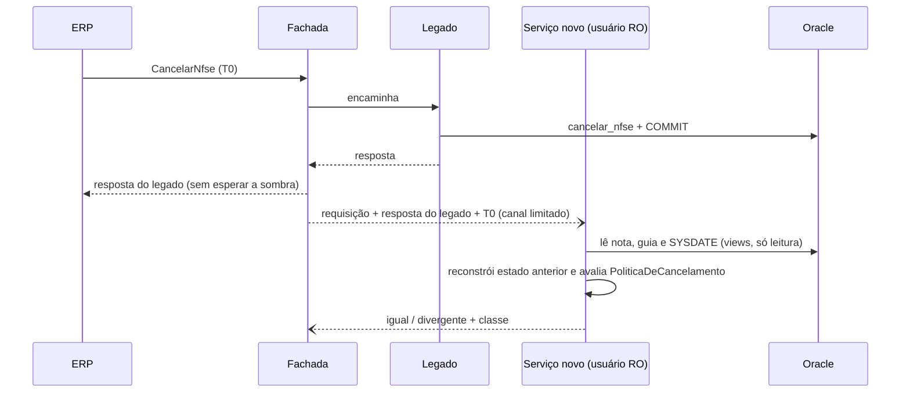

# ADR-0009 — Sombra por operação, escrita única e idempotência

- **Status:** Aceito
- **Data:** 2026-10-16
- **Relacionados:** [0002](0002-propriedade-dos-dados-na-transicao.md), [0003](0003-regras-de-cancelamento-em-plsql.md), [0004](0004-comportamentos-legados-nao-documentados.md), [0008](0008-fachada-yarp-roteamento-e-flags.md), [0012](0012-observabilidade-seguranca-e-lgpd.md)

## Contexto

Requisitos da sombra:

- o cliente recebe a resposta do legado;
- o novo processa a mesma requisição e as respostas são comparadas;
- cada divergência é registrada de forma reproduzível, sem expor dados pessoais;
- a sombra não pode piorar a latência nem a disponibilidade.

Restrição global: **nenhuma escrita executada duas vezes por causa da arquitetura**.

"Sombra" não significa o mesmo para leitura e escrita. Executar `CancelarNfse` nos dois sistemas cancelaria duas vezes. "Dry-run com rollback" também não serve, porque o `COMMIT` autônomo do trigger escapa do rollback ([ADR-0003](0003-regras-de-cancelamento-em-plsql.md)).

## Decisão

### 1. Execução da sombra (comum às operações)

- A fachada responde ao cliente com a resposta do legado **assim que ela chega**; a sombra nunca está no caminho da resposta.
- A requisição (já bufferizada), a resposta do legado e `T0` (instante de recebimento) vão para um **canal em memória limitado** (`System.Threading.Channels`). Canal cheio → descarta e incrementa `sombra_descartadas_total`. Nunca bloqueia.
- Workers com pool e limites próprios chamam o serviço novo com timeout próprio.
- **Amostragem** por operação (flag `sombra.amostragem`, semântica em [ADR-0008](0008-fachada-yarp-roteamento-e-flags.md)), começando em 1% (degraus do [plano](../plano-de-migracao.md), §5) para não dobrar a carga no Oracle. A decisão de amostrar é tomada **depois** da resposta do legado: respostas em chave rara (`E050`, `E051`, `E053`, `E001`, `E030`, janela do prazo) vão sempre para a sombra, fora da rampa ([plano de migração](../plano-de-migracao.md), §5.4).
- Falha ou timeout do novo na sombra é registrado como `erro_novo` e nunca afeta o cliente.
- No serviço novo, toda avaliação de sombra usa o pool `NFSE_MODERNO_RO`, que **não tem privilégio de escrita nem de execução do wrapper** ([ADR-0002](0002-propriedade-dos-dados-na-transicao.md)). A garantia de "sombra não escreve" é do banco.

### 2. Sombra de leitura (`ConsultarNfse`, `ConsultarNfseServicoTomado`)

- O novo executa a mesma requisição pelo adaptador SOAP ([ADR-0006](0006-camada-anticorrupcao.md)); a fachada compara os bytes do `outputXML`. Em divergência, a diferença é localizada por XML canônico (caminhos XPath que divergem). Nenhum campo é ignorado por padrão.
- **Corrida de dados:** se a nota foi emitida ou cancelada entre as duas leituras, haverá divergência legítima. Em divergência, o worker **reexecuta uma vez legado e novo** (leituras são seguras). Se a reexecução coincidir, a divergência é classificada como `corrida`.
- A reexecução tem **limite de taxa** por operação (padrão 1 por segundo). Em `ServicoTomado`, cada reexecução do legado é um full scan (`/*+ FULL(n) */`); acima do limite, a divergência fica `nao_classificada`. A taxa de reexecução é métrica.

### 3. Sombra do cancelamento (`CancelarNfse`): avaliação sem escrita

O novo **nunca escreve** em modo sombra. Ele expõe um endpoint interno `POST /interno/sombra/cancelamento`, numa porta separada, restrito por NetworkPolicy à fachada. O endpoint avalia a **decisão** sobre o **estado anterior reconstruído**:

1. A fachada encaminha ao legado e, após a resposta, envia ao novo: requisição original, resposta do legado e `T0`.
2. O novo lê, pelas views, o estado atual da nota e da guia e o `SYSDATE` do banco.
3. Converte `T0` para o relógio do banco: `T0b = T0 + (SYSDATE lido − instante local da leitura)`, **truncado para o segundo** (`DATE` não tem fração).
4. Reconstrói o estado anterior:

| Resposta do legado | Estado atual | Estado anterior reconstruído | Observação |
| --- | --- | --- | --- |
| `E001`, `E010` | — | não se aplica | compara só a validação feita no adaptador (nenhuma nota é lida) |
| `E050` | nota inexistente | inexistente | |
| `E051`, `E052` | inalterado | igual ao atual | |
| `E053` | inalterado | igual ao atual | |
| sucesso, `DT_CANCELAMENTO ≥ T0b − 2 s` | `C` | `N` (o legado acabou de cancelar) | janela de 2 s cobre skew e truncamento |
| sucesso, `DT_CANCELAMENTO < T0b − 2 s` | `C` | `C` (já estava cancelada, K01) | |
| `soap:Fault` | qualquer | **indeterminado** | K09/K11: o legado pode ter commitado; não avalia |

5. Avalia `PoliticaDeCancelamento` com o estado anterior e `agora = T0b`, e monta a resposta SOAP que **teria** devolvido, usando o `DataHora` da própria resposta do legado (o novo não pode produzir outro instante sem escrever).
6. Compara a decisão (código de retorno ou sucesso) e os campos ecoados.

Limitações aceitas, cada uma com classe própria:

- avaliar sobre o estado atual seria inútil: depois do cancelamento a nota está `C` e qualquer avaliação devolveria "já cancelada = sucesso", escondendo bugs de prazo e guia paga;
- uma guia paga **entre** a resposta do legado e a leitura da sombra gera um falso `E053`. É classificada como `corrida` se `GUIAS.DT_ATUALIZACAO > T0b`;
- divergências a menos de 2 s da fronteira do prazo (dia 10 → 11) são `fronteira_relogio`.

### 4. Classificação e registro de divergências

Classes **automáticas**, atribuídas pelo serviço novo: `nao_classificada` (padrão), `corrida`, `fronteira_relogio`, `indeterminado`, `erro_novo`, `decisao_consciente` (quando o caso casa com uma regra conhecida do [ADR-0004](0004-comportamentos-legados-nao-documentados.md), ex.: C15, C20, C28).

Classes de **triagem humana**, atribuídas depois na análise: `bug_novo`, `bug_legado`. A triagem gera um caso no golden master ([ADR-0011](0011-paridade-golden-master.md)).

O registro (log estruturado + métrica, nunca no Oracle) contém:

- operação, modo, `traceId`, classe, caminhos XPath que divergem, hash de cada resposta;
- requisição **pseudonimizada**: CPF/CNPJ, razões sociais **e inscrição municipal** substituídos por HMAC-SHA256 com chave rotacionável (a IM de um MEI identifica uma pessoa). Número da nota, período e página ficam em claro;
- para reprodução exata, o payload original **cifrado** (AES-GCM, chave em secret), retido por 15 dias e acessível só pelo papel de operação. *(Fase 2: no MVP, a pseudonimização basta para reproduzir com o seed.)*

### 5. Escrita única

| Modo do `CancelarNfse` | Quem escreve | Retry da fachada | Em timeout |
| --- | --- | --- | --- |
| `legado` | legado | nunca | Fault (como hoje) |
| `sombra` | **só o legado**; o novo só avalia (usuário só de leitura) | nunca | Fault (como hoje) |
| `novo` | **só o novo** (wrapper PL/SQL); o legado não recebe | nunca | Fault; o ERP pode reenviar (K01) |

- A fachada tem retry **desabilitado** na rota de cancelamento e não faz fallback depois de enviar ([ADR-0008](0008-fachada-yarp-roteamento-e-flags.md)).
- Afinidade por prestador no canário: o mesmo prestador cancela sempre pelo mesmo lado.
- No caminho novo, o `FOR UPDATE` do wrapper impede o segundo `UPDATE` em cancelamentos concorrentes (K08).
- **Risco residual:** no canário, um cancelamento pelo legado e outro pelo novo da mesma nota exigiriam dois ERPs diferentes cancelando a mesma nota do mesmo prestador ao mesmo tempo. A afinidade por prestador torna isso impossível pela fachada. O legado sem lock continua com o comportamento de hoje (K08) para o tráfego que ainda atende.

### 6. Idempotência

- **O cancelamento já é idempotente por natureza** (K01): repetir o mesmo cancelamento devolve sucesso com o mesmo `DataHora`, sem nova escrita. Essa propriedade é preservada de propósito nos dois contratos.
- **SOAP:** reenvio seguro, como hoje.
- **REST:** `POST .../cancelamento` repetido devolve `200` com o mesmo recurso. Concorrência é serializada pelo lock do wrapper. **Não há tabela de idempotência.** O header `Idempotency-Key` é aceito e propagado para logs e traces (correlação de reenvios), mas não é obrigatório.
- Se no futuro o cancelamento ganhar efeitos não idempotentes (ex.: notificação ao tomador), uma tabela de chaves gravada **na mesma transação** do cancelamento passa a ser necessária.

### Números desta ADR

| Valor | Origem | Onde calibrar |
| --- | --- | --- |
| Amostragem inicial de 1% | [H] | carga extra no Oracle medida no teste de carga; sobe por degraus no plano |
| Reexecução de leitura divergente limitada a 1 por segundo | [H] | custo do full scan de `ServicoTomado` medido no teste de carga |
| Janela de 2 s na reconstrução do cancelamento | [H] | skew fachada × banco medido; precisão de `DATE` |
| Retenção de 15 dias do payload cifrado (fase 2) | [H] | tempo de triagem de uma divergência; validar com o encarregado de dados |

## Fora deste ADR

| Pendência | Dono | Trava |
| --- | --- | --- |
| Aprovação da pseudonimização e da retenção pelo encarregado de dados (DPO) | DPO | a sombra em produção (qualquer operação) |
| Critérios estatísticos de saída da sombra (N, limite inferior de Wilson, códigos raros) | time de modernização | o avanço de `sombra` para `novo`; definidos no [plano de migração](../plano-de-migracao.md) |
| Payload cifrado para reprodução exata | time de modernização | nada; fase 2 |
| Sombra invertida em modo `novo` | time de modernização | nada; fase 2 |

## Alternativas consideradas

- **Sombra síncrona (esperar os dois e responder com o legado).** Rejeitada: piora a latência para o pior dos dois.
- **Mirroring de mesh/proxy.** Rejeitada: descarta a resposta da cópia e duplica a escrita ([ADR-0008](0008-fachada-yarp-roteamento-e-flags.md)).
- **Cancelamento em sombra com rollback.** Rejeitada: o efeito autônomo persiste (inclusive criação de guia) e há disputa de lock com o cliente real.
- **Avaliar o cancelamento antes de encaminhar ao legado** (snapshot no caminho síncrono). Rejeitada: acrescenta uma leitura ao caminho do cliente; a reconstrução atinge o mesmo resultado fora dele.
- **Tabela de `Idempotency-Key` obrigatória na REST.** Rejeitada: duplica uma garantia que a regra já oferece e introduz estados novos (chave em processamento, chave órfã após queda) sem benefício.
- **Registrar divergências em tabela no Oracle.** Rejeitada: carga extra no banco compartilhado e dados pessoais em mais um lugar.

## Consequências

- **Positivas:** sombra útil inclusive para escrita, sem possibilidade de dupla escrita (garantida por privilégio); divergências classificadas e reproduzíveis.
- **Negativas:** a sombra de leitura acrescenta carga ao Oracle (controlada por amostragem e limite de reexecução); a reconstrução do estado anterior é lógica a mais a testar; a sombra do cancelamento valida a **decisão**, não o `DataHora`.
- **Riscos:** corridas reais classificadas erroneamente como `corrida`. Mitigado pela reexecução e pelo acompanhamento da taxa por classe.

## Reversão

`sombra.amostragem = 0` ou modo `legado` para a operação. Nenhum efeito persistente.

## Como verificar

- Teste de resiliência: novo parado ou com latência de 30 s em modo sombra → p99 do cliente igual ao do modo `legado` (dentro do orçamento da fachada).
- Teste: canal cheio descarta sem bloquear e incrementa a métrica.
- Teste: a avaliação de sombra usa `NFSE_MODERNO_RO`; tentar chamar o wrapper por esse pool falha com `PLS-00201`.
- Teste: cada linha da tabela de reconstrução, incluindo cancelamento repetido, Fault e fronteira de prazo, com relógio injetado (sem depender de `FIXED_DATE`, [ADR-0011](0011-paridade-golden-master.md)).
- Teste REST: o mesmo cancelamento enviado 10× em paralelo → um único `UPDATE`, 10 respostas `200` iguais.
