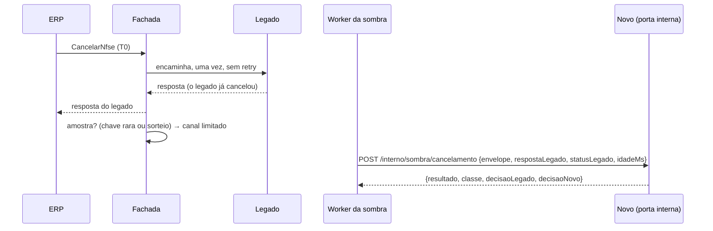

# Nfse.Fachada

Proxy north-south na frente de `/NfseWS.asmx` ([ADR-0008](../../docs/adr/0008-fachada-yarp-roteamento-e-flags.md)). Decide, por operação, entre o legado e o serviço novo. Não tem regra de NFS-e, nem banco, nem estado além do kill switch administrativo da réplica.

Estado atual: **M0** do [plano](../../docs/plano-de-migracao.md). As flags de [`flags.json`](flags.json) deixam as três operações em `legado`. A decisão de destino está pronta e testada, e a sombra também: das leituras e do cancelamento ([Sombra](#sombra)).

## Fluxo

| Requisição | Caminho |
| --- | --- |
| `POST /NfseWS.asmx`, operação fora do escopo (C21/C29: sufixo do `SOAPAction`, sensível a maiúsculas) | legado, em streaming, sem ler o corpo, sem retry |
| `POST /NfseWS.asmx`, `ConsultarNfse`, `ConsultarNfseServicoTomado` ou `CancelarNfse` | [`DecisorDeDestino`](Roteamento/DecisorDeDestino.cs): kill switch → modo → listas → `xxHash64(op\|chave) % 100 < percentual` |
| `GET /NfseWS.asmx?wsdl`, `/health` e qualquer outro caminho | legado, sem alteração |
| `/health/live`, `/health/ready` | a própria fachada (`ready` exige flags carregadas) |
| `/admin/kill-switch` | só na porta interna, com token |

Os dois planos são separados no roteamento pela porta local da conexão ([`PortaDoEndpoint`](Configuracao/PortaDoEndpoint.cs)). Na porta interna só existem os endpoints `/admin`: SOAP, pass-through e health dão 404 e nada chega ao legado. Na porta pública, `/admin/...` dá 404 e também não vai ao legado. A separação não usa `RequireHost`, porque o header Host vem do cliente e, atrás do ingress, não traz a porta do Kestrel. `Fachada:Porta` e `Admin:Porta` precisam ser diferentes: o processo não sobe se forem iguais.

Nas operações em escopo, o corpo só é bufferizado (até 1 MiB) quando a decisão depende da chave, ou seja, em `sombra` ou `novo`. A chave é a IM do prestador (`ConsultarNfse`, `CancelarNfse`) ou o documento do consulente, só com dígitos (`ConsultarNfseServicoTomado`). O parsing é seguro: sem DTD e sem resolução externa. Se a chave não for extraída ou o corpo passar do limite, a requisição vai ao legado, exceto em `novo` com 100%.

Falha no novo:

- **Leitura:** erro de transporte ou de conexão, timeout, ou HTTP 502, 503 ou 504 levam a **uma** tentativa no legado. Um HTTP 500 do novo vai ao cliente como veio: é o `soap:Fault` que o novo devolve de propósito, como o legado (C20). Repeti-lo levaria a requisição duas vezes ao Oracle e poluiria a métrica de fallback.
- **`CancelarNfse`:** sem retry e sem fallback. A exceção é falha ao abrir a conexão (`ConnectionError`/`NameResolutionError`), porque aí o corpo não saiu. Timeout ou erro depois do envio devolvem o mesmo `soap:Fault` `soap:Server` do legado.

## Sombra

Implementa as seções 1 a 5 da [ADR-0009](../../docs/adr/0009-sombra-escrita-unica-e-idempotencia.md). O código fica em [`Sombra/`](Sombra). As leituras (`ConsultarNfse`, `ConsultarNfseServicoTomado`) são repetidas no novo e comparadas em bytes. O `CancelarNfse` só é avaliado pelo novo, sem escrita ([Sombra do cancelamento](#sombra-do-cancelamento)).

```mermaid
sequenceDiagram
    participant E as ERP
    participant F as Fachada
    participant L as Legado
    participant W as Worker da sombra
    participant N as Serviço novo
    E->>F: ConsultarNfse (T0)
    F->>L: encaminha (YARP)
    L-->>F: resposta
    F-->>E: resposta do legado (tee copia o corpo, até 1 MiB)
    F->>F: amostra? (chave rara ou sorteio) → canal limitado
    W->>N: mesmo POST /NfseWS.asmx e SOAPAction (cliente HTTP próprio)
    N-->>W: resposta
    W->>W: compara bytes e status; divergiu → reexecuta legado e novo uma vez → classifica
```

1. **Caminho do cliente.** Em `sombra`, com `Decisao.ElegivelParaSombra`, `Novo__Url` configurada e corpo bufferizado, o corpo da resposta do legado passa por um tee ([`CapturaDaResposta`](Sombra/CapturaDaResposta.cs)). Cada bloco vai primeiro ao cliente e só depois é copiado. A cópia para em 1 MiB, mas o cliente continua recebendo tudo.
2. **Amostragem.** É decidida depois da resposta. Uma resposta em chave rara (`Sombra__ChavesRaras`, padrão `E001`, `E030`, `E050`, `E051` e `E053`) vai sempre, mesmo com amostragem 0. Fora disso, vai uma fração `Sombra.Amostragem` (0..100) da operação. O código é lido do `outputXML` do legado. O parsing só acontece se a resposta contiver `ListaMensagemRetorno`, e uma página de notas não chega a ser parseada.
3. **Canal.** A cópia leva a requisição, a resposta, o status, `T0` e o contexto do trace, e vai para um `Channel` limitado. Com o canal cheio, a cópia é descartada (`canal_cheio`) e a publicação não bloqueia. Também são descartadas, depois do sorteio, a resposta acima de 1 MiB (`resposta_grande`), a requisição acima de 1 MiB (`requisicao_grande`) e a falha ao encaminhar ao legado (`falha_legado`).
4. **Workers.** São `Sombra__Concorrencia` consumidores, num `BackgroundService` ([`TrabalhadorDaSombra`](Sombra/TrabalhadorDaSombra.cs)), com um cliente HTTP só da sombra ([`ClientesDaSombra`](Sombra/ClientesDaSombra.cs)). Cada chamada tem o timeout `Sombra__Timeout`. O trace de cada cópia é próprio e tem span link para o da requisição original.
5. **Comparação (leituras).** São comparados os bytes do corpo e o status. Na divergência, a classificação ([`ClassificadorDeDivergencia`](Sombra/ClassificadorDeDivergencia.cs)) segue esta ordem:

| Condição | Classe |
| --- | --- |
| timeout ou erro de transporte do novo | `erro_novo` (não conta como comparação) |
| os dois devolvem `soap:Fault` `soap:Server`, com textos diferentes | `decisao_consciente`, regra **C20** |
| novo com status 5xx | `erro_novo` |
| pedido com `<!DOCTYPE` (no envelope ou escapado no `inputXML`) | `decisao_consciente`, regra **C28** |
| reexecução de legado e novo, em paralelo, coincide | `corrida` |
| reexecução diverge, falha ou passa do limite (`Sombra__ReexecucoesPorSegundo`, por operação) | `nao_classificada` |

### Sombra do cancelamento

**Regra de ouro:** em `sombra`, quem cancela é só o legado, uma vez. A fachada nunca repete o cancelamento: nem no legado (não há reexecução nem retry) nem no `/NfseWS.asmx` do novo, que cancelaria de novo. O novo só avalia a **decisão** sobre o estado anterior reconstruído, com o usuário só de leitura (ADR-0009, seção 3).



- **Caminho do cliente:** o mesmo das leituras (passos 1 a 3): elegibilidade, captura, chave rara depois da resposta (`E050`, `E051`, `E053` e `E001` vão sempre) e canal. O mesmo pool de workers atende as três operações, com um caminho por operação ([`AvaliadorDoCancelamento`](Sombra/AvaliadorDoCancelamento.cs)).
- **Contrato:** `POST {Novo__UrlInterna}/interno/sombra/cancelamento` com JSON `{ "envelope", "respostaLegado", "statusLegado", "idadeMs" }`. `envelope` e `respostaLegado` são os corpos brutos, em claro, pela rede interna (nunca vão ao log). `idadeMs` é o tempo, no `Stopwatch` da fachada, entre o recebimento da requisição do ERP e o envio da cópia: o novo reconstrói `T0` no relógio do banco sem comparar relógios de máquinas diferentes. Um `soap:Fault` do legado também vai, com `statusLegado` 500: o novo devolve `indeterminado`.
- **Resposta:** 200 com `{ "resultado": "igual" | "divergente", "classe", "decisaoLegado", "decisaoNovo" }`. A classe vem do novo (`nao_classificada`, `corrida`, `fronteira_relogio`, `indeterminado` ou `decisao_consciente`; `null` vale `nao_classificada`). Outro status, timeout (`Sombra__Timeout`), erro de transporte, JSON inválido, ou resultado ou classe fora da lista viram `erro_novo` (um valor desconhecido nunca vira label).
- **Sem `Novo__UrlInterna`:** a cópia sorteada é descartada com motivo `sem_url_interna` e o novo não é chamado.
- **Registro:** "igual" em `Debug` (evento 20). Na divergência, `Warning` (evento 25) com classe, `traceId`, as decisões dos dois lados (só se forem códigos curtos, como `E053` ou `sucesso`; senão `?`), o status e o SHA-256 da resposta do legado e o pedido pseudonimizado como nas leituras. O `erro_novo` sai no evento 22.
- **Modo `novo`:** nada muda. O cancelamento vai só ao novo, sem retry nem fallback depois do envio, e não há sombra invertida (fase 2).

### Registro da divergência

É um log `Warning` (evento 21 nas leituras, 25 no cancelamento), nunca gravado no Oracle. Leva operação, classe, regra, `traceId` da requisição original, status dos dois lados, SHA-256 de cada resposta, até 10 caminhos XPath divergentes do `outputXML` ([`DiferencaXml`](Sombra/DiferencaXml.cs), que usa o envelope quando não há `outputXML`, como num Fault) e a requisição pseudonimizada ([`Pseudonimizador`](Sombra/Pseudonimizador.cs)).

**Pseudonimização.** Cada valor do `inputXML` vira `hmac:` seguido do HMAC-SHA256 em hexadecimal, com a chave `Sombra__ChaveHmac`. A regra é uma lista de permissão: só `Numero`, `NumeroNfse`, `DataInicial`, `DataFinal` e `Pagina` ficam em claro. CPF/CNPJ, razões sociais, IM e qualquer outro campo saem pseudonimizados.

- Sem chave, ou com pedido malformado (por exemplo, com DTD), a requisição aparece como `omitida` e o registro leva só os hashes.
- As respostas nunca entram no log.
- O "igual" e os descartes saem em `Debug`.

**Limitações.** A classificação da fachada só olha o protocolo (Fault, DTD). As classes de negócio do cancelamento (`fronteira_relogio`, `indeterminado`) são do serviço novo (ADR-0008). A sombra do cancelamento valida a decisão, não o `DataHora`. Ainda não há unidade de amostra por (chave, operação, resposta, dia) nem acúmulo estatístico (plano, §5.2 e §5.3): isso fica na análise das métricas e dos logs. O sorteio da amostragem é por requisição, não por chave.

## Configuração

| Chave (env) | Padrão | |
| --- | --- | --- |
| `Legado__Url` | `http://webservices:8080` | obrigatória |
| `Legado__Timeout` | `00:01:40` | inatividade máxima (o legado não tem limite próprio) |
| `Novo__Url` | — | sem ela, o destino `novo` cai no legado |
| `Novo__UrlInterna` | — | porta interna do novo (ex.: `http://nfse-novo:8081`), só da fachada; sem ela, a sombra do cancelamento descarta (`sem_url_interna`) |
| `Novo__TimeoutLeitura` / `Novo__TimeoutCancelamento` | 5 s / 10 s | inatividade máxima na chamada ao novo |
| `Fachada__Porta` | `8080` | porta pública |
| `Flags__Fonte` | `arquivo` | `arquivo` (seção `Migracao` do arquivo abaixo) ou `openfeature` (flagd); outro valor impede a partida |
| `Fachada__ArquivoDeFlags` | `flags.json` | caminho relativo ao content root, ou absoluto; só com `Flags__Fonte=arquivo` |
| `Flags__Flagd__Host` / `Flags__Flagd__Porta` | `FLAGD_HOST` / `FLAGD_PORT`, senão `localhost` / `8015` | sync do flagd (in-process); só com `openfeature` |
| `Flags__Flagd__Seletor` | `FLAGD_SOURCE_SELECTOR` | fonte do flagd a sincronizar (em produção, `nfse/nfse-migracao`: o flagd registra a fonte Kubernetes sem o prefixo `core.openfeature.dev/`); vazio, todas |
| `Admin__Porta` | `8081` | porta interna dos endpoints administrativos |
| `Admin__Token` | — | segredo do header `X-Admin-Token`; vazio fecha os endpoints |
| `Sombra__CapacidadeDoCanal` | `1000` | cópias aguardando worker; lido na partida |
| `Sombra__Concorrencia` | `4` | workers da sombra; lido na partida |
| `Sombra__Timeout` | `00:00:05` | duração máxima de cada chamada da sombra (novo, reexecução do legado e avaliação do cancelamento) |
| `Sombra__ReexecucoesPorSegundo` | `1` | reexecuções de divergência por segundo, por operação; `0` desliga |
| `Sombra__ChavesRaras__0`, `__1`, ... | `E001`, `E030`, `E050`, `E051`, `E053` | códigos que vão sempre para a sombra |
| `Sombra__ChaveHmac` | — | segredo do HMAC da pseudonimização; vazio, o registro leva só os hashes |
| `OTEL_EXPORTER_OTLP_ENDPOINT` | — | coletor OTLP (no compose, `http://otel-lgtm:4317`); sem ela, nada é exportado |

## Flags

Duas fontes, escolhidas por `Flags__Fonte`: o arquivo (`arquivo`, padrão, usado no compose e nos testes) e OpenFeature + flagd (`openfeature`, [abaixo](#openfeature--flagd), usado em produção). As duas montam o mesmo retrato, e o `DecisorDeDestino` não sabe de qual veio.

No arquivo, as flags ficam na seção `Migracao`. O arquivo é observado e recarregado sem restart. Em volume montado num container, use `DOTNET_USE_POLLING_FILE_WATCHER=true` (polling a cada 4 s).

```json
{
  "Migracao": {
    "KillSwitch": false,
    "Operacoes": {
      "ConsultarNfse": {
        "Modo": "novo",
        "Percentual": 5,
        "KillSwitch": false,
        "Inclusao": ["10000001"],
        "Exclusao": [],
        "Sombra": { "Amostragem": 0 }
      }
    }
  }
}
```

- Uma operação ausente fica em `legado`.
- `Percentual` só vale em `novo`. `Sombra.Amostragem` só vale em `sombra`, nas três operações.
- As listas contêm IMs (ou documentos só com dígitos, em `ConsultarNfseServicoTomado`).
- **Fail-safe:** com arquivo ausente, JSON inválido, valor que não converte (`"Modo": "talvez"`) ou percentual fora de 0..100, a fonte devolve `null`. Nesse caso tudo vai ao legado e `/health/ready` responde 503.

No compose, as flags vêm de [`deploy/flags/flags.json`](../../deploy/flags/flags.json), montado em `/config/flags`: edite o arquivo e a fachada recarrega em até ~4 s, sem rebuild nem restart.

### OpenFeature + flagd

Com `Flags__Fonte=openfeature`, o mesmo retrato `FlagsDeMigracao` vem de flags OpenFeature avaliadas pelo provider flagd ([`FonteDeFlagsOpenFeature`](Flags/FonteDeFlagsOpenFeature.cs)), como decide a ADR-0008. É o que o overlay de produção do Kubernetes usa.

| Chave OpenFeature | Tipo | Equivale, no arquivo, a |
| --- | --- | --- |
| `migracao.kill-switch` | booleano | `Migracao.KillSwitch` |
| `<Operacao>.kill-switch` | booleano | `Operacoes.<Operacao>.KillSwitch` |
| `<Operacao>.config` | objeto `{ Modo, Percentual, Inclusao, Exclusao, Sombra: { Amostragem } }` | o resto de `Operacoes.<Operacao>` |

`<Operacao>` é `ConsultarNfse`, `ConsultarNfseServicoTomado` ou `CancelarNfse`. Por que este esquema:

- **É o do `FeatureFlag` que já existia** em [`deploy/k8s/overlays/producao/flagd`](../../deploy/k8s/overlays/producao/flagd/featureflag.yaml). Nem o CR nem o `DecisorDeDestino` mudam: a fonte só monta o mesmo `FlagsDeMigracao` da fonte por arquivo.
- **Kill switch em booleano à parte**: ligar é trocar o `defaultVariant` de uma flag, sem reescrever o objeto da operação. Desligar com pressa não passa por editar JSON.
- **Um objeto por operação, não uma flag por campo**: modo, percentual e listas mudam juntos. Com flags separadas, uma mudança de `sombra` para `novo` com percentual poderia ser vista pela metade.

Como a fonte funciona:

- **Listas como texto no flagd:** `Inclusao` e `Exclusao` vão como texto separado por vírgulas (`"10000001,10000002"`). O provider in-process (`OpenFeature.Contrib.Providers.Flagd` 0.4.0 e 0.5.0) devolve `TYPE_MISMATCH` para flag de objeto que contém lista; a fonte aceita os dois formatos, e o arquivo continua com listas JSON.
- O provider roda em **modo in-process**: recebe o conjunto de flags pelo stream de sync do flagd (porta 8015, gRPC `flagd.sync.v1`) e avalia na própria fachada. Não há polling nem RPC por requisição. A cada evento do provider (pronto ou configuração alterada), a fonte reavalia as 7 flags fora do caminho da requisição e troca o retrato. `Atual()` só lê o retrato pronto.
- O resolvedor RPC não é usado: na versão 0.4.0 do provider ele desiste do stream de eventos depois de 3 tentativas, e o retrato ficaria congelado sem erro (um kill switch não chegaria).
- **Fail-safe idêntico ao do arquivo**: provider ainda sem retrato ou em erro (flagd fora, stream caído), flag ausente ou desabilitada, tipo errado, campo desconhecido no objeto, modo que não é `legado`/`sombra`/`novo`, percentual não inteiro ou fora de 0..100 → `null`. Tudo vai ao legado e `/health/ready` responde 503. O log sai só nas transições. Campo ausente no objeto fica no padrão, como no arquivo.
- O erro do provider é acompanhado pelos eventos, não só pelo status do SDK: ao reconectar, o flagd in-process emite apenas "configuração alterada", e o status do SDK continuaria em erro. Configuração recebida faz a fonte voltar a valer.
- O span de cada requisição em escopo leva `migracao.fonte_flags` (`arquivo` ou `openfeature`), junto de `migracao.modo`.

No compose, o flagd é opcional (profile `flagd`) e serve [`deploy/flags/flagd.json`](../../deploy/flags/flagd.json), que espelha o `flags.json` no formato do flagd e é observado pelo próprio flagd:

```bash
FACHADA_FLAGS_FONTE=openfeature docker compose --profile flagd up -d
```

Edite `deploy/flags/flagd.json` (por exemplo, o `defaultVariant` de `migracao.kill-switch` para `ligado`). O flagd publica a mudança no stream e a fachada a aplica em segundos. Para conferir o que o flagd está servindo:

```bash
curl -s -X POST -H 'Content-Type: application/json' -d '{}' http://127.0.0.1:8013/flagd.evaluation.v1.Service/ResolveAll
```

## Kill switch nível 2

Vale imediatamente **nesta réplica**. O operador aplica o comando em todas as réplicas (plano, seção 8). O estado fica em memória e se perde no restart: para durar, use o nível 1 (`KillSwitch` no arquivo de flags).

```bash
curl -X POST   -H "X-Admin-Token: $TOKEN" http://fachada:8081/admin/kill-switch                       # global
curl -X POST   -H "X-Admin-Token: $TOKEN" "http://fachada:8081/admin/kill-switch?operacao=CancelarNfse"  # uma operação
curl -X DELETE -H "X-Admin-Token: $TOKEN" http://fachada:8081/admin/kill-switch                       # desliga o global
curl           -H "X-Admin-Token: $TOKEN" http://fachada:8081/admin/kill-switch                       # estado
```

## Observabilidade

- Os logs são estruturados ([`Log.cs`](Observabilidade/Log.cs)) e trazem operação, destino, motivo, status e duração. Nunca trazem IM, documento ou corpo. Um nome de operação desconhecido aparece como `desconhecida`.
- O registro do OpenTelemetry é comum à fachada e ao serviço novo ([`Nfse.Observabilidade`](../Nfse.Observabilidade/RegistroDaTelemetria.cs)): traces de ASP.NET Core e HttpClient (o cliente do YARP cria o span filho da chamada ao destino e propaga `traceparent`), métricas de runtime, ASP.NET Core, HttpClient e do meter `Nfse.Fachada`, e logs pelo OTLP. No console, os logs saem em JSON com `TraceId` e `SpanId` no escopo. `/health/live` e `/health/ready` ficam fora dos traces.
- [`Telemetria`](Observabilidade/Telemetria.cs) põe `soap.operacao`, `migracao.modo`, `migracao.destino` e `migracao.motivo_roteamento` no `Activity` da requisição. O motivo fica **só** no span.
- O `Meter` `Nfse.Fachada` publica as métricas da ADR-0012:

| Métrica | Labels | O que mede |
| --- | --- | --- |
| `nfse_requisicoes_total` | `operacao`, `modo`, `destino`, `resultado` | uma por requisição SOAP; `destino` é quem respondeu, depois de um eventual fallback |
| `nfse_duracao` | `operacao`, `destino` | cada chamada ao legado ou ao novo |
| `nfse_fallback_total` | `operacao`, `causa` | idas ao legado depois de falha no novo |
| `fachada_overhead` | `operacao` | tempo da requisição SOAP fora das chamadas aos destinos (orçamento da ADR-0008); inclui a leitura do corpo bufferizado |
| `migracao_modo_info` (gauge) | `operacao`, `modo`, `percentual` | modo configurado por operação ([`MedidoresDeEstado`](Observabilidade/MedidoresDeEstado.cs)) |
| `kill_switch_ativo` (gauge) | — | 1 se algum kill switch, do arquivo ou administrativo, está ligado |
| `sombra_comparacoes_total` | `operacao`, `resultado` (`igual`, `divergente`) | comparações em bytes de corpo e status (leituras) ou o resultado da avaliação do novo (cancelamento) |
| `sombra_divergencias_total` | `operacao`, `classe` | divergências e falhas do novo, por classe automática (no cancelamento, a devolvida pelo novo) |
| `sombra_descartadas_total` | `operacao`, `motivo` | cópias amostradas e não comparadas (`canal_cheio`, `resposta_grande`, `requisicao_grande`, `falha_legado`, `novo_nao_configurado`, `sem_url_interna`) |
| `sombra_reexecucoes_total` | `operacao`, `resultado` (`coincidiu`, `divergiu`, `erro`, `limitada`) | custo da reexecução; nunca existe para `CancelarNfse` |
| `sombra_atraso` | `operacao` | de `T0` ao fim da comparação |

- `modo` vale `legado`, `sombra`, `novo` ou `indisponivel` (flags não lidas). Operação fora do escopo conta como `legado` e operação desconhecida aparece como `desconhecida`.
- `resultado` vale `ok` (2xx) ou `fault` (o resto). `erro_negocio` ainda não existe, porque exige ler o corpo da resposta (ver TODO).
- `causa` vale `conexao`, `transporte`, `timeout`, `http_502`, `http_503` ou `http_504`.
- Nenhuma IM ou documento vira label.
- O cliente HTTP propaga `traceparent`.
- Os histogramas usam buckets em segundos (o padrão do SDK pressupõe milissegundos).
- No Prometheus, o OTLP acrescenta o sufixo da unidade aos histogramas: `nfse_duracao_seconds_bucket`, `fachada_overhead_seconds_bucket` e `sombra_atraso_seconds_bucket`. Os contadores e os gauges ficam com o nome da ADR.
- No compose, o dashboard **Migração por operação** fica no Grafana do `otel-lgtm` (pasta NFS-e), provisionado de [`deploy/grafana`](../../deploy/grafana). A linha **Sombra** mostra a taxa de divergência por classe, as comparações e reexecuções, os descartes por motivo e o atraso p99.

## TODO

- [x] **OpenFeature + flagd** (ADR-0008): `FonteDeFlagsOpenFeature`, com o provider flagd in-process (sync por stream), o mesmo retrato `FlagsDeMigracao`, o fail-safe para `null` e `migracao.fonte_flags` no span ([OpenFeature + flagd](#openfeature--flagd)). Validado no compose em 2026-10-19 contra o flagd v0.11.1: mudança de modo aplicada em 1,6 s e kill switch global em 0,4 s **[M]**.
- [x] **OpenTelemetry** (ADR-0012): tracing, métricas e logs exportados por OTLP, `fachada_overhead`, span filho da chamada ao destino (instrumentação do HttpClient) e os gauges `migracao_modo_info` e `kill_switch_ativo`.
- [ ] Resultado `erro_negocio` (resposta 200 com `ListaMensagemRetorno`): a sombra já captura o corpo e lê os códigos (`XmlSoap.CodigosDeRetorno`), mas só nas operações em `sombra`.
- [ ] Pseudonimização (HMAC) de documentos e IMs num processador de logs (ADR-0012). A sombra já pseudonimiza o pedido no registro da divergência; o processador vale como defesa para logs novos.
- [x] **Sombra das leituras** (ADR-0009, seções 1, 2 e 4).
- [x] **Sombra do cancelamento** (ADR-0009, seção 3): requisição, resposta e `idadeMs` ao `POST /interno/sombra/cancelamento` do novo, que avalia sem escrever.
- [ ] Janela do prazo como chave rara (plano, §5.4), junto da sombra do cancelamento.
- [ ] Payload cifrado (AES-GCM) para reprodução exata (ADR-0009, fase 2).
- [ ] Timeout total (não só de inatividade) por operação no novo, se a medição do M0 mostrar necessidade.
- [x] [Dockerfile](Dockerfile) e serviço `fachada` no [`docker-compose.yml`](../../docker-compose.yml), com as flags montadas de [`deploy/flags`](../../deploy/flags/flags.json).
